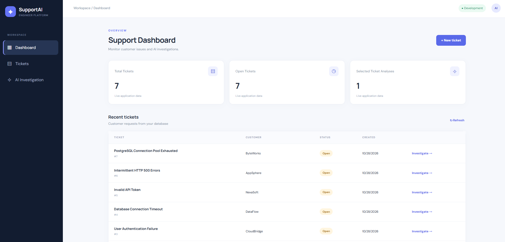
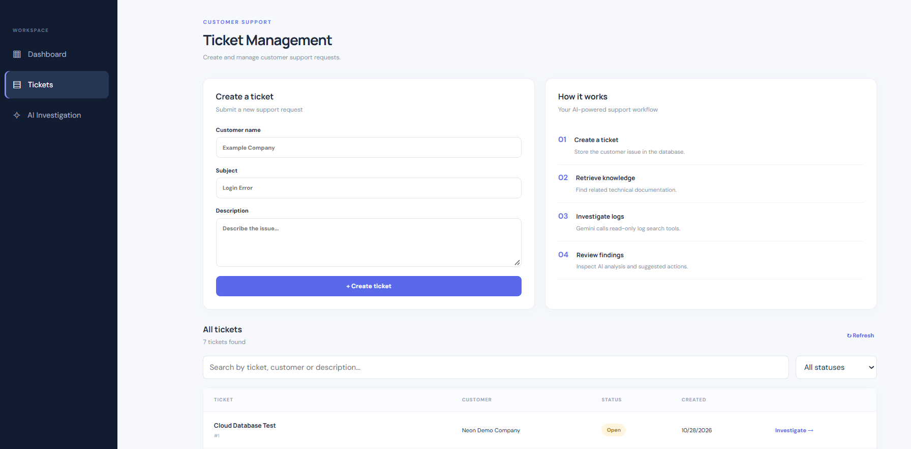
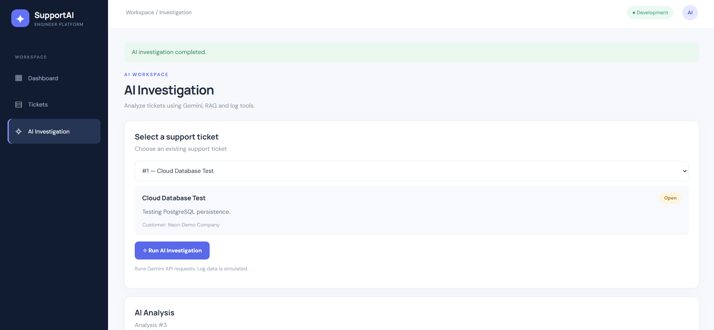
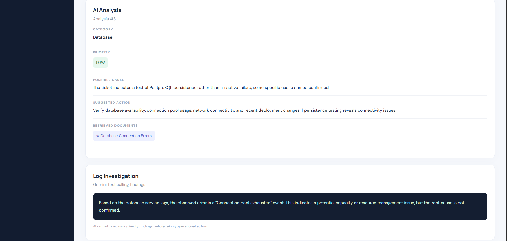

# SupportAI — AI Support Engineer Platform


An AI-powered customer support investigation platform built with React, FastAPI, Google Gemini, Retrieval-Augmented Generation (RAG), and tool calling.


SupportAI helps support engineers investigate technical issues by combining structured AI analysis, relevant knowledge base documents, and simulated system logs in a single workflow.


## Key Features


- **Ticket Management:** Create, view, search, and filter customer support tickets.

- **AI-Powered Analysis:** Classify issues, assign priorities, identify possible causes, and recommend next steps using Google Gemini.

- **Retrieval-Augmented Generation (RAG):** Retrieve relevant technical documentation to provide context for AI analysis.

- **AI Tool Calling:** Allow Gemini to invoke a read-only log search tool.

- **Full Investigation:** Combine knowledge base analysis and log investigation in one workflow.

- **Investigation History:** Save and review previous AI analyses.

- **Database Persistence:** Use SQLite locally and Neon PostgreSQL in production.

- **Demo Access Protection:** Restrict API access using a server-side access key.

- **Daily AI Request Quota:** Limit production AI investigation requests to 10 per UTC day.

- **Automated Testing:** Run backend tests and frontend builds through GitHub Actions.


## Tech Stack


| Layer | Technologies |

|---|---|

| Frontend | React, Vite, JavaScript, CSS |

| Backend | Python, FastAPI, Pydantic |

| AI | Google Gemini, Google Gen AI SDK |

| Retrieval | Keyword-based RAG, JSON Knowledge Base |

| Tool Calling | Gemini Function Calling, Python |

| Databases | SQLite, Neon PostgreSQL |

| Containers | Docker |

| CI/CD | GitHub Actions |

| Deployment | Render |

| Testing | pytest, FastAPI TestClient |


## System Architecture


```text

                  User / Browser

                        |

                        v

                  React Frontend

                        |

                        v

                  FastAPI Backend

                        |

          +-------------+-------------+

          |             |             |

          v             v             v

     Ticket API     RAG Retrieval   Log Search Tool

          |             |             |

          v             +------+------+ 

   Neon PostgreSQL             |

                               v

                         Google Gemini

                               |

                               v

                     AI Investigation Results

                               |

                               v

                         React Dashboard

```


The production application runs as a single Render Web Service. Docker builds the React frontend and includes its compiled assets in the FastAPI container.


Neon PostgreSQL stores support tickets, investigation history, and daily AI request counts.


## AI Investigation Workflow


1\. A user creates or selects a support ticket.

2\. FastAPI retrieves the ticket from the database.

3\. The RAG service selects relevant internal knowledge base documents using keyword matching.

4\. Google Gemini generates a structured ticket analysis.

5\. Gemini can call a read-only Python tool to search simulated application logs.

6\. The frontend displays the AI analysis and log investigation findings.

7\. The structured analysis is saved to the database for later review.


**Note:** The log investigation uses simulated demonstration data, not logs from actual customer production systems. AI findings are advisory and should be verified before operational action.


## Project Structure


```text

ai-support-engineer/

|

|-- app.py

|-- database.py

|-- llm\_service.py

|-- rag\_service.py

|-- log\_service.py

|-- tool\_service.py

|-- knowledge\_base.json

|-- requirements.txt

|-- Dockerfile

|

|-- frontend/

|   |-- src/

|   |   |-- App.jsx

|   |   |-- api.js

|   |   |-- App.css

|   |-- package.json

|

|-- tests/

|   |-- test\_api.py

|   |-- test\_rate\_limit.py

|

|-- .github/

|   |-- workflows/

|       |-- ci.yml

|

|-- README.md

```


## Run Locally with Docker


### 1. Clone the repository


```bash

git clone https://github.com/sevvaluzun/ai-support-engineer.git

cd ai-support-engineer

```


### 2. Configure environment variables


Create a `.env` file in the project root:


```dotenv

GEMINI\_API\_KEY=your\_gemini\_api\_key

```


Do not commit API keys or database credentials to Git.


By default, the application uses SQLite when `DATABASE\_URL` is not configured.


### 3. Build the Docker image


```bash

docker build -t supportai .

```


### 4. Run the application


```bash

docker run --rm -p 127.0.0.1:8000:8000 \\

  -v supportai-data:/app/data \\

  --env-file .env \\

  supportai

```


Open:


http://127.0.0.1:8000/


### 5. Run the tests


```bash

docker run --rm --entrypoint python supportai -m pytest tests/ -v

```


The test suite uses mock AI responses and isolated database fixtures. Running the tests does not require actual Gemini API calls.


## Production Deployment


The application is deployed on Render using Docker.


Production configuration requires:


| Variable | Purpose |

|---|---|

| `APP\_ENV` | Set to `production` |

| `DATABASE\_URL` | Neon PostgreSQL connection string |

| `GEMINI\_API\_KEY` | Google Gemini API credentials |

| `DEMO\_ACCESS\_KEY` | Shared demo API access key |


The production API rejects requests if demo access protection is not configured.


The daily request limit is tracked in PostgreSQL to retain quota counts across application restarts.


## Security and Limitations


- API access is restricted using a shared demo key.

- The demo key is supplied at runtime and is not embedded in the frontend source.

- The frontend stores the entered key in memory for the active page session.

- Production AI investigation requests are limited to 10 per UTC day.

- Log investigation uses simulated, read-only data.

- The application does not include production-grade authentication, user roles, or tenant isolation.

- The application is intended as an educational and portfolio demonstration.


## Live Demo


**Live application:** https://ai-support-engineer.onrender.com


The live demonstration requires a demo access key, which is not published in this repository.


## Screenshots


### Support Dashboard




### Ticket Management




### AI Investigation




### AI Analysis and Log Investigation




## Future Improvements


- Role-based authentication and authorization

- Semantic search with vector embeddings

- Integrations with real monitoring and ticketing systems

- Per-user AI usage tracking

- Improved observability and audit logging

- Automated PostgreSQL integration tests


## Project Purpose


This project demonstrates end-to-end AI application engineering, including API development, LLM integration, retrieval, tool calling, database persistence, containerization, automated testing, and cloud deployment.


Built as a hands-on AI Support Engineer portfolio project.


